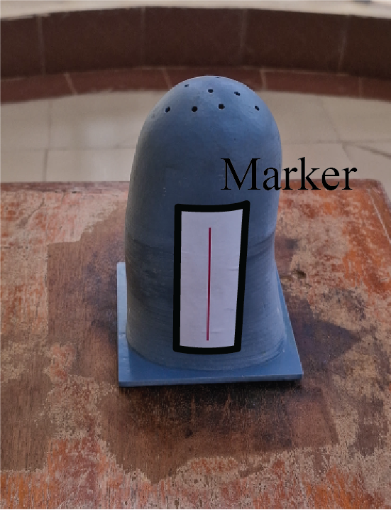

# Find-Marker

Find-Marker is a Python workflow for estimating the length of a colored marker in a COLMAP 3D reconstruction. The current detector is tuned for a magenta marker that contrasts with the surrounding surface. The workflow visualizes and filters the point cloud, isolates the target region, extracts the marker points, and fits a 3D curve to estimate its arc length.

The photo below shows the kind of physical marker this workflow is intended to measure.



## Requirements

- Python 3.12.10 (specified in `requirements.txt`)
- A text-format COLMAP `points3D.txt` file with point coordinates and RGB colors
- The Python packages listed in `requirements.txt`

The interactive point-cloud viewers use Open3D. Without Open3D, visualization is unavailable, though the processing scripts can still run where their other dependencies are installed.

## Installation

From the repository directory, create and activate a virtual environment, then install the pinned dependencies:

```powershell
py -3.12 -m venv .venv
.\.venv\Scripts\Activate.ps1
python -m pip install --upgrade pip
python -m pip install -r requirements.txt
```

Confirm that the virtual environment is using the expected Python version:

```powershell
python --version
```

## End-to-end workflow

Run the stages below in order from the repository directory. Replace `.\path\to\points3D.txt` with your COLMAP text-format point-cloud file. Each stage after visualization consumes the output created by the previous processing stage.

### 1. Visualize the original point cloud

This optional first look helps confirm that the reconstruction loaded correctly and that the marker and target surface are visible.

```powershell
python visualize_point_cloud.py --file .\path\to\points3D.txt
```

This step opens an interactive viewer and does not create an intermediate file. You can use this viewer to inspect intermediate files from the later stages as well.

### 2. Clean and inspect the point cloud

Remove pure-black points, identify the densest spatial region, and save the density-bounded cloud for the next stage:

```powershell
python colmap_point_cloud_processor.py `
  --file .\path\to\points3D.txt `
  --remove-black `
  --filter-by-density `
  --show-bbox `
  --histogram `
  --output .\filtered_points.txt
```

The processor uses the density region to crop the input cloud and writes the result to `filtered_points.txt`. The bounding-box view and point-distribution histogram help inspect the crop. Density filtering uses a default voxel size of `0.05` and density percentile of `75`; adjust them for the scale and density of your reconstruction. Use `--help` to see all options.

### 3. Isolate the white/light target region

Find the densest cluster of white/light points in the processed cloud and save all points inside its oriented bounding box:

```powershell
python colmap_white_region_extractor.py `
  --file .\filtered_points.txt `
  --output .\marker.txt
```

The default white threshold is `200` on each RGB channel. The extracted file includes all points inside the detected region, not only white points, so the colored marker points remain available for the next step. The script also displays the color distribution and an oriented bounding box. If needed, tune `--white-threshold`, `--voxel-size`, and `--density-percentile`; use `--stats-only` to save the region without opening the 3D viewer.

### 4. Detect the magenta marker and project its points

Run marker extraction on the isolated region:

```powershell
python magenta_marker_plane_projector.py --file .\marker.txt
```

The script selects magenta points, fits a RANSAC plane, projects the inlier points onto that plane, and normally opens a 3D visualization. By default it writes these files to the current working directory:

- `pointData.txt` — point IDs, original 3D coordinates, and 2D coordinates on the fitted plane.
- `magenta_plane_data.npz` — compressed point and plane data.
- `plane_visualization.png` — the 2D projection with a point-distribution histogram.

Use `--no-viz` to skip the interactive 3D view. If the marker is not detected reliably, review the crop and adjust the detector's `--color-threshold` and plane-fitting options.

### 5. Fit the marker curve and estimate its length

Fit the curve using the generated `pointData.txt`:

```powershell
python marker_curve_fitting_.py `
  --data .\pointData.txt `
  --original .\marker.txt
```

The script fits a smoothed parametric 3D curve, displays it with the isolated point cloud, and prints `Fitted 3D curve length`. The measurement is in the coordinate units of the COLMAP reconstruction. COLMAP reconstructions are not necessarily in real-world units, so ensure the model has been scaled or calibrated before interpreting the result as a physical length.

## Intermediate files

The default commands create these files in the repository's current working directory:

| File | Created by | Used by |
| --- | --- | --- |
| `filtered_points.txt` | `colmap_point_cloud_processor.py` | `colmap_white_region_extractor.py` |
| `marker.txt` | `colmap_white_region_extractor.py` | `magenta_marker_plane_projector.py` and curve visualization |
| `pointData.txt` | `magenta_marker_plane_projector.py` | `marker_curve_fitting_.py` |
| `magenta_plane_data.npz` | `magenta_marker_plane_projector.py` | Saved data for later analysis |
| `plane_visualization.png` | `magenta_marker_plane_projector.py` | Visual review of the 2D projection |

These output files are overwritten when the corresponding scripts are run again from the same directory. Run `python <script>.py --help` for the available options and defaults of each command.

## Main scripts

- `visualize_point_cloud.py` — view a COLMAP point cloud with its RGB colors.
- `colmap_point_cloud_processor.py` — remove black points, inspect the cloud, and crop around its densest region.
- `colmap_white_region_extractor.py` — locate the densest white/light region and save points inside its oriented bounding box.
- `magenta_marker_plane_projector.py` — extract magenta points, fit a plane, and create projected point data.
- `marker_curve_fitting_.py` — fit a 3D curve to marker points and report its arc length.

## Test data
You can find test data output from the marker detection and curve-fitting pipeline in the `Test Data` folder. The data is organized into subfolders for each test case.

